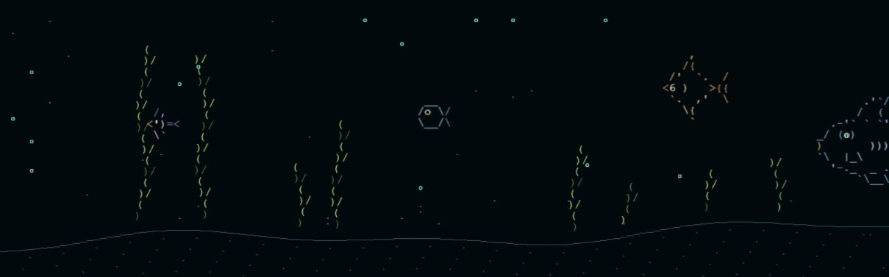

# ASCII Genesis — Raspberry Pi

A traveling ASCII ocean for **Raspberry Pi 4 + Waveshare 7.9-inch HDMI touchscreen**, displayed horizontally at **1280 × 400**.

## With thanks to the projects that started it

ASCII Genesis grew from **[Asciiquarium](https://github.com/cmatsuoka/asciiquarium)**, created by **Kirk Baucom**, with most original ASCII art credited to **Joan Stark** and expanded marine biodiversity by **Claudio Matsuoka**. Their shared work gave this ocean its foundation and much of its character.

**[OpenGhost](https://github.com/xanderchinxyz/OpenGhost)** by **xanderchinxyz and its contributors** inspired the early exploration of a small physical display. Thank you to both projects and the people who made them possible. Read the [full credits and project origins](CREDITS.md).

We call ASCII Genesis an **ocean**: its creatures travel through a scrolling world of changing terrain and habitats.

**This repository is the Raspberry Pi project.** The ESP32 board has a separate project: **[ASCII Genesis - Mini](https://github.com/Mikepyt87/ascii-genesis-mini)**. The two projects have different hardware, installers, controls, and update systems.

## Start here

| Your situation | What to do |
| --- | --- |
| Building the Pi ocean for the first time | Follow [Raspberry Pi installation and operation](raspberry-pi/SETUP.md) from the hardware section onward |
| Choosing/printing the case and legs | Follow [3D printing and assembly](3d-printing/README.md); these files are for the Pi display |
| Already installed and want new creatures | Close the ocean, run the **Update ASCII Genesis** desktop icon, then reopen the ocean |
| Want to see the artwork and behavior | Open the [Ocean Library](docs/OCEAN-LIBRARY.md) or [screenshot tour](docs/SCREENSHOTS.md) |
| Have the little ESP32-S3 1.47-inch screen | Use [the Mini's first-install guide](https://github.com/Mikepyt87/ascii-genesis-mini/blob/main/docs/INSTALL.md); do not run the Pi installer |

## Pi hardware

- Raspberry Pi 4 Model B, cooling, a microSD card, and a suitable 5 V / 3 A USB-C supply.
- Waveshare 7.9-inch HDMI touch display, used sideways at **1280 wide × 400 high**.
- Micro-HDMI-to-HDMI video cable and the display's USB touch cable.
- Raspberry Pi OS **Desktop, 64-bit**; keyboard/mouse for first setup.
- One printed case and two legs if using the included enclosure build.

The display connects to the Pi over HDMI and USB. This is a Linux desktop application, not ESP32 firmware. The Mini's display driver, flashing offsets, Wi-Fi setup address, and USB binaries do not apply to this project.

## First software installation on the Pi

Use the [complete guide](raspberry-pi/SETUP.md) to set the display rotation and touch alignment first. Then open a terminal **on the Raspberry Pi**:

```bash
sudo apt update
sudo apt install -y git
git clone https://github.com/Mikepyt87/ascii-genesis.git "$HOME/ASCII-Genesis"
bash "$HOME/ASCII-Genesis/raspberry-pi/install.sh"
```

Open **ASCII Genesis** from the desktop. The installer creates **Update ASCII Genesis** too. If the folder already exists, use the update instructions instead of cloning over it. [The full guide](raspberry-pi/SETUP.md) explains desktop trust prompts, first launch, closing, boot startup, printing, optional narration, and troubleshooting.

## What the Pi ocean includes

There are 28 creature and vehicle designs, including the peacock mantis shrimp, plus the Pi edition's ecosystem, schools, occasional encounters, diver, changing terrain, day/night lighting, quiet mode, and two-minute creature parade. It runs offline. Optional OpenAI narration has its own setup in the complete guide; no API key is needed for the ocean itself.

Surface stretches bring sailing boats, whales that surface and spout, and a Nessie-like sea monster, one visitor at a time. Castles and submerged ruins pass along the seabed. Sparse bubbles rise from creatures, with at most three on screen at once. The parade keeps its own clear view. See the [surface scenes and landmarks guide](docs/SURFACE-SCENES.md) for artwork, timing, and bubble behavior.

**Pi scrolling speed is unchanged.** The Mini's faster scrolling and sequential parade belong to the other project.



## Updates and source

The Pi updater follows this repository's **main** branch. Close the ocean before running **Update ASCII Genesis**. It checks the candidate before updating and refuses to overwrite local edits. It does not download Mini firmware releases.

The renderer and creature code are in `simulator/`; Pi installers/launchers are in `raspberry-pi/`. Tests run in GitHub Actions. The old `esp32/` links redirect to the standalone Mini repository; its implementation and ongoing development have moved there. Historical Mini firmware releases remain available so installed boards can move to the new update channel.

## Credits

Built on **Asciiquarium by Kirk Baucom**, with most upstream ASCII art credited to **Joan Stark** and expanded biodiversity by **Claudio Matsuoka**. **OpenGhost / xanderchinxyz** inspired the early display exploration. Project additions include the renderer, ecosystem, original creatures, and physical Pi enclosure. Read [CREDITS.md](CREDITS.md), [THIRD-PARTY.txt](THIRD-PARTY.txt), and [LICENSE.txt](LICENSE.txt).
