# ASCII Genesis Screenshot Tour

ASCII Genesis is a quiet, traveling ASCII ocean for a Raspberry Pi 4 and a Waveshare 7.9-inch HDMI touchscreen. Fish pass through the scene at different speeds while the seabed and seaweed scroll slowly past. This tour shows what to expect before building your own.

These are desktop previews at **1280 × 400**, rather than photographs of the Pi. The gallery illustrates individual features and includes earlier captures; it is not an exhaustive picture of every current addition. The [surface scenes guide](SURFACE-SCENES.md) documents the new boat, spouting whale, sea monster, castles, ruins, and bubble limits. Existing JPEGs are browser captures; the new PNG previews below use the same renderer through a Canvas harness. Scenes were advanced and held still, including rare visitors and encounters. Actual visits are spaced out during normal use, and every new world varies.

The gallery includes earlier captures. Jellyfish, crabs, lobsters, mantis shrimp, sharks, and whales have since been redrawn for [balanced proportions](CREATURE-SIZES.md); the current dimensions and actual drawings are in the library.

## Lionfish

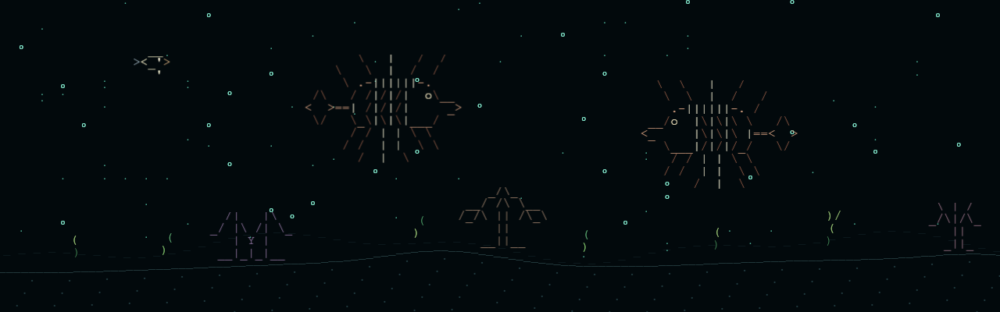

A staged Canvas-renderer preview of the original lionfish drawing facing both directions. It joins ordinary arrivals and the two-minute parade. See its [library entry](OCEAN-LIBRARY.md#lionfish) for both drawings, colors, and behavior.

## Thanks to the original creators

Much of the character of this ocean comes from [Asciiquarium](https://github.com/cmatsuoka/asciiquarium): **Kirk Baucom** created the original project, **Joan Stark** is credited upstream for most of its ASCII art, and **Claudio Matsuoka** expanded its marine biodiversity. Eleven fish designs here adapt their shared work. **xanderchinxyz and the [OpenGhost](https://github.com/xanderchinxyz/OpenGhost) contributors** inspired the initial physical-display exploration. Please visit their projects and read [Credits and project origins](../CREDITS.md).

## Traveling ocean

Different fish shapes and muted colors share the water with algae and plankton. Seaweed varies in height and shade. The camera moves slowly through kelp meadow, rocky reef, and open sand settings; plants and terrain enter and leave at the edges. Fish crossing an edge are intentional arrivals and departures.

The current collection has **28 creature and vehicle designs**, each facing both directions. There are at most eight swimmers at once, including those still outside the visible area. The [Ocean Library](OCEAN-LIBRARY.md) shows every drawing and explains its role.

## Squid and octopus

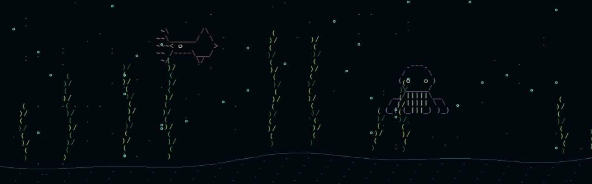

Two original ASCII Genesis cephalopods join the rotation: a rose squid with a pointed mantle and trailing tentacles, and a violet octopus with a rounded head and curling arms. They share the eight-creature limit and enter and leave beyond an edge. The squid cruises through the water; the octopus now follows the seabed. This historical capture predates that grounded placement. Neither joins hunts.

## Sea turtle and creature parade

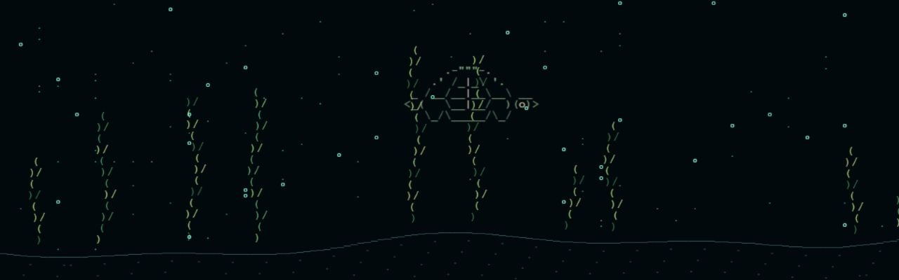

The collection now includes 28 creature and vehicle designs, including the sea turtle and lionfish. Its original project artwork includes a green shell, flippers, and a small head. Both swimming directions are included in the [Ocean Library](OCEAN-LIBRARY.md#sea-turtle).

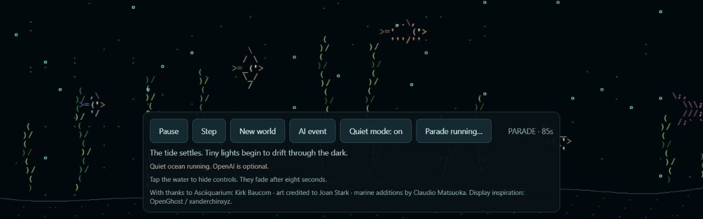

Tap **Creature parade · 2 min** to show the entire lineup. Creatures cross from beyond the left edge to beyond the right edge in four staggered lanes. The normal ecosystem is preserved during the showcase and resumes after two minutes. Pause and Step apply to the parade, and New world cancels it. The timer and button remain in the touch panel, which still hides automatically.

## Open sand

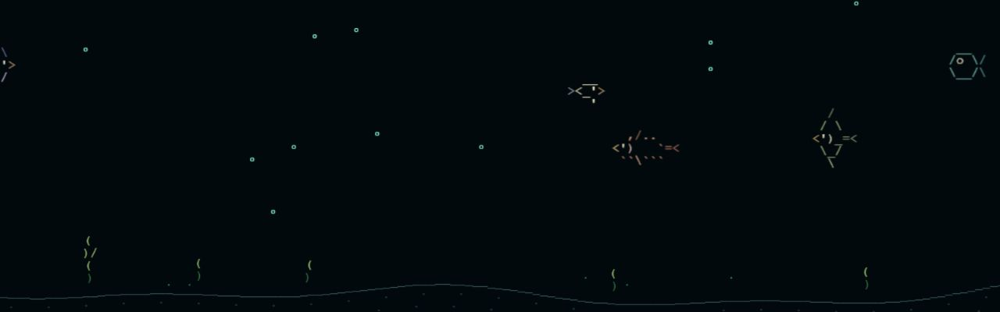

Travel gradually changes the setting. Open sand has a lower seabed and shorter, more widely visible gaps between plants than the denser regions. Food availability also changes with habitat. Transitions blend smoothly instead of cutting between separate scenes.

## A visiting diver

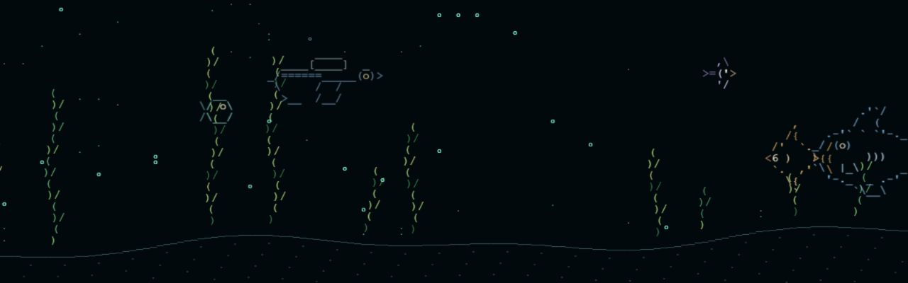

A diver occasionally swims across with gently alternating flippers and a small trail of bubbles. The first visit is scheduled after 5–10 minutes; another wait begins after departure. An active encounter can delay the visit. The diver stays separate from the eight-fish limit, and its bubbles share the three-bubble limit with ordinary fish.

## Bottom creatures and the larger wreck

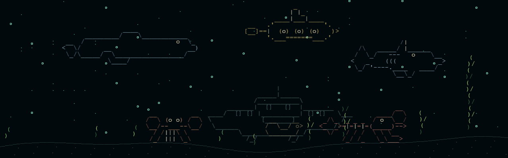

This staged Canvas-renderer preview shows the five new designs together. Crab and lobster feet follow the floor, including during the parade. The shark can join occasional hunts; the regular humpback whale glides through the rotation, while the yellow submarine is a decorative vehicle. The wreck is nine rows tall and over four times the peeking eel's width. The complete library includes all 28 regular designs in one collection.

## Predator encounter

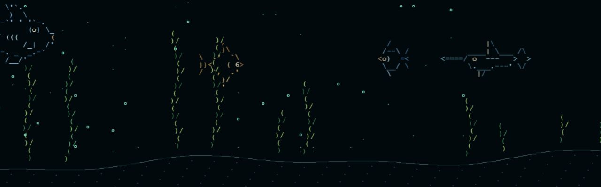

A silver spearfish follows a smaller reef fish in this example. Encounter pairs arrive together from beyond an edge, then briefly accelerate once both are in view. Most chases end in escape. Rare successful catches visibly shrink the prey into the predator's mouth; there is no blood, flashing, or sound.

Only one encounter can run at a time. A 2–4 minute cooldown, available swimmer slots, and the time to enter the scene keep these moments spaced apart. **Quiet mode** disables hunting while keeping normal swimming and diver visits.

## Jellyfish, coral gardens, and discoveries

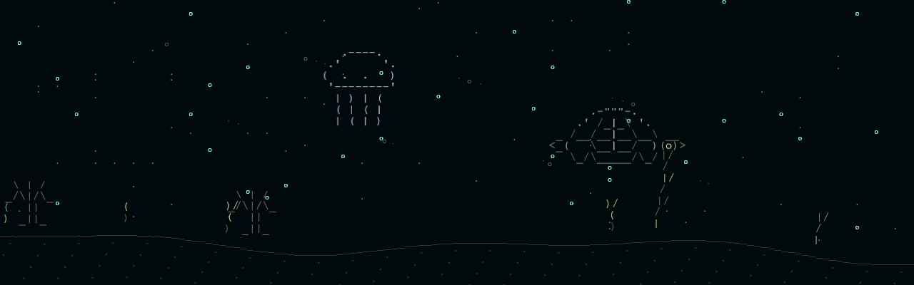

The new moon jellyfish drifts upward and pulses gently. Coral gardens add sparse branching scenery attached to the scrolling seabed. The glowing patch is a short decorative discovery with 18 marks; it does not add ecological plankton.

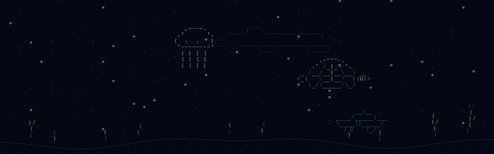

The ocean now includes six habitats. This staged night preview shows the shipwreck depths and a rare distant whale. The eel peeks from a wreck during its own brief windows. A remembered lighting button chooses a 20-minute ocean cycle or the Pi's local clock. Small schools, gliding rays, surfacing turtles, and seabed octopuses add movement variety during normal running.

## Terrain variety

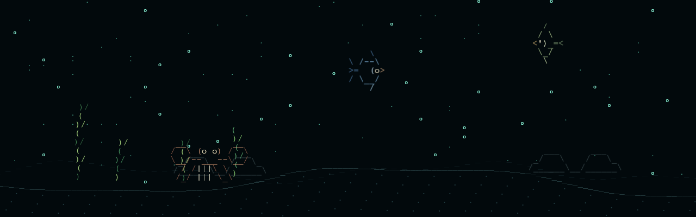

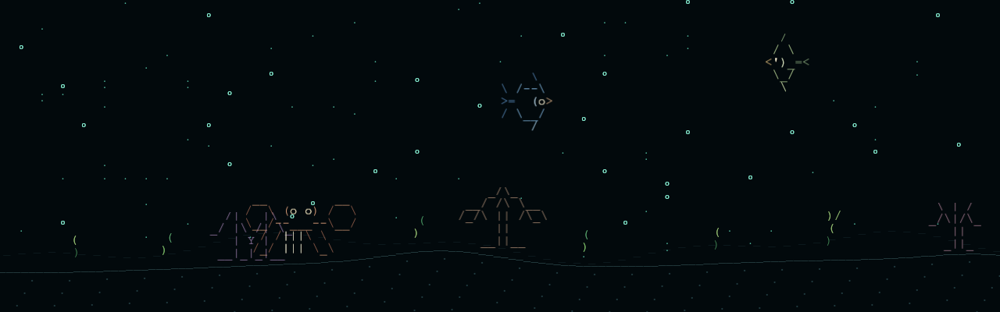

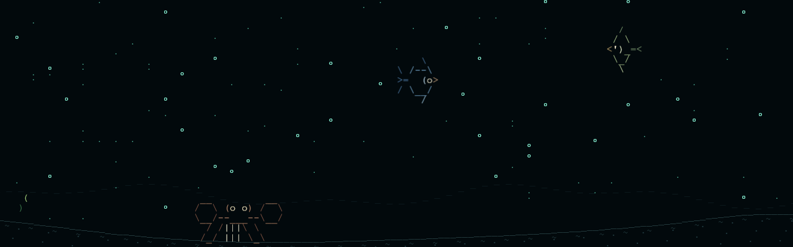

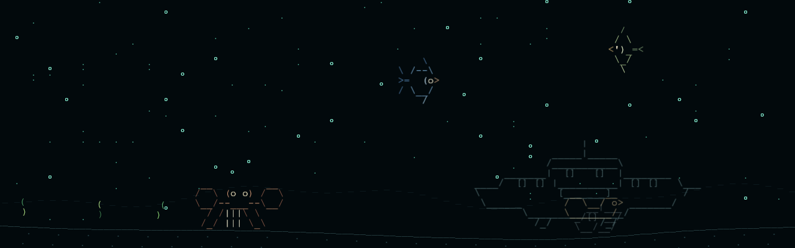

These staged Canvas-renderer previews show habitat-specific contours and world-anchored scenery. Foreground plants, sediment, rocks, and wrecks scroll together. Only the faint distant ridge uses a slower camera for depth. Landmarks and plant patches are determined by the world seed, so normal journeys vary. See the [complete object library](OCEAN-LIBRARY.md#terrain-landmarks) for all drawings and behavior.

## Touch controls

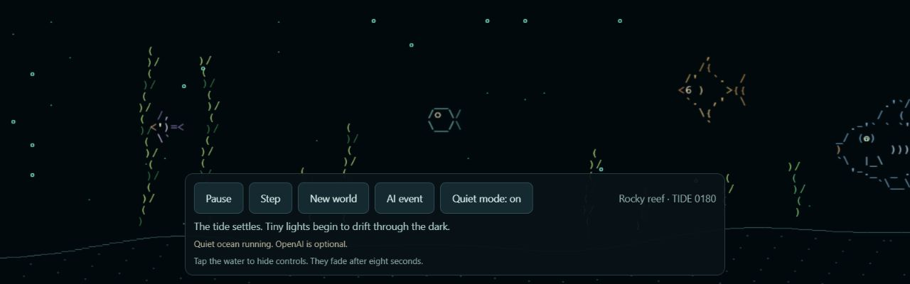

Tap the water to reveal this panel. It fades after eight seconds so the ocean can fill the display again.

| Control | What it does |
| --- | --- |
| Pause or Resume | Stops or resumes swimming, travel, visitors, and encounters. |
| Step | Advances the whole simulation by one tick, useful while paused. |
| New world | Starts a fresh scene and resets its timers. |
| Close ocean | Returns to the Pi desktop when opened through the desktop launcher. |
| Lighting | Switches between the ocean cycle and local-clock lighting. |
| AI event | Requests optional narration through your own configured OpenAI API connection. It does not control the ocean. |
| Creature parade | Shows all 28 designs in a two-minute lineup, then returns to the normal ocean. |
| Quiet mode | Turns hunting off or on. The preference is remembered in the browser profile. |

The ocean, diver, and encounters all work **offline without an API key**. The AI button requires separate setup and working API access; the screenshot does not demonstrate a successful API call.

## New surface scenes

The ocean occasionally reaches a visible waterline, with one sailing boat, spouting whale, or long-necked monster at a time. Castles and ruins scroll through the bottom third. The [surface scenes guide](SURFACE-SCENES.md) shows the actual drawings and explains timing, sparse bubbles, and parade behavior. These additions are separate from the older gallery’s distant-whale and glow discoveries.

## Build and run it

The supported setup is a **Raspberry Pi 4 Model B, Raspberry Pi OS Desktop 64-bit, and the Waveshare 7.9-inch screen rotated to 1280 × 400**. For the included enclosure build, print **one case and two legs** from the [print guide](../3d-printing/README.md). The installer adds native Raspberry Pi desktop launch and update icons. Open the ocean with its desktop icon; tap the water, then **Close ocean** to return to the desktop. Alt+F4 also works. Older control screenshots predate the Close and Lighting buttons.

See the [README](../README.md) for the hardware list, installation from GitHub, updates, and troubleshooting. See [artwork credits](../THIRD-PARTY.txt) for the Asciiquarium sources and original project drawings, distributed under GPL-2.0-or-later.
